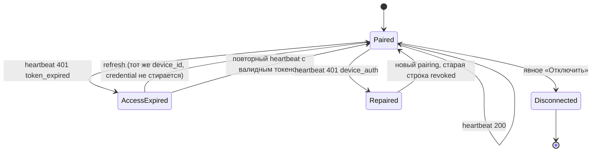

# Canalla LLM — финальная автономная приёмка
## Windows 1.2.5 · установленный updater · device identity · T3/T4 · long autonomy

Дата: **28.10.2026** (UTC-сессия 27.10.2026 22:00–23:00)
Агент: Zed №5, существующее рабочее дерево, без нового Worktree.
Репозиторий: `volkrist/canalla-llm` (remote `alex-llm.git` → redirect)
Ветка: `release/canalla-1.2.4`

---

## 0. Сводка

| Направление | Статус |
|---|---|
| A. Чистая Windows-установка 1.2.5 (fresh OS) | **BLOCKED** (нет изолированной интерактивной Windows; статические проверки — PASS) |
| B. Установленный Tauri-updater E2E (1.2.3/1.2.4 → 1.2.5) | **BLOCKED** (production-цепочка проверена, требует GUI-стенда) |
| B'. Production updater manifest + подпись + анонимная загрузка | **PASS** (9/9 матрица, подпись VERIFIED) |
| C. Device identity при истечении токена | **PASS** |
| C'. Read-only аудит 58 исторических записей | **PASS** (ничего не удалено) |
| T3 — перезапуск UI посреди задачи | **BLOCKED** (live-сценария в harness нет; свободная часть выполнена) |
| T4 — отключение Computer host посреди задачи | **BLOCKED** (то же) |
| Long autonomy 15–30 model-origin вызовов | **FAIL** (2 прогона, evidence сохранён; 1 дефект исправлен) |
| Ubuntu .deb/AppImage | вне области этого задания |
| Windows Release 1.2.6 | **НЕ выпущен** |

Платные ресурсы: **2 Pod**, фактически **$0.3930**, `pods []`, watchdog `disarmed`, AI `off`.

---

## 1. Git, продукт, CI

| Параметр | Значение |
|---|---|
| Ветка | `release/canalla-1.2.4` |
| HEAD на входе | `8829df9c67193385120c34122408cf42119e3b7b` = tag `v1.2.5` |
| HEAD на выходе | `e8f56b7` (два коммита: исправление D1 + формат docstring), запушен |
| Теги | `v1.2.3`, `v1.2.4`, `v1.2.5` не изменялись |
| Установленная версия | **1.2.5** (`FileVersion`/`ProductVersion` = 1.2.5) |
| CI на `8829df9` | 7/7 PASS (run 40521282418), Linux gate PASS (40526113500) |
| CI на `e8f56b7` | **7/7 PASS** (run 40598244685), Linux gate **PASS** (40598244803) |

Незакоммиченные изменения на входе: только двоичный шум `docs/screenshots/0.4/*.png`
(не коммитился) и stat-only записи `package.json` / `Cargo.toml` / `tauri.conf.json`
(`git diff` пуст). Ничего чужого не тронуто, force-push не выполнялся.

### Точные digest установленного и публичного

| Файл | SHA-256 | Размер |
|---|---|---|
| `alex-llm.exe` (desktop, установлен) | `153dc62bd0c85dfeb48857064f8154a5a1c4e8f8c60f1c36c8963a9257f61e45` | 6 002 176 |
| `alex-host-loop.exe` (установлен) | `262a1f8428a3a98df19b53dbdeed899f3d6516335bc4833f461c69d66f1300d6` | 2 208 256 |
| `sidecar/alex-backend/alex-backend.exe` | `f9046b83bb94db3b75e6224d1fa27fc6eae75fd302a0b28f130eeb6f1e63f953` | 23 804 166 |
| `runtime/tor/tor.exe` | `8c38513b3c4584154158e7c584f4144849dc679a64cd679553d72dad28230c54` | 10 237 952 |
| `Canalla.LLM_1.2.5_x64-setup.exe` (публичный) | `b90a6ee23ecac9922514830cb2b832e11697353c7b7a130de05bb16f46d8426b` | 95 468 784 |
| `Canalla.LLM_1.2.5_x64-setup.exe.sig` | `75b21e31847ac0fd769e798373cac67cb96eeb4c52376fc270407ebe05830c3a` | 424 |

Provenance backend (`sidecar/alex-backend/build-stamp.json`, установленный):

```json
{"product": "alex-llm", "product_version": "1.2.5",
 "source_digest": "b9aef542a9e334621953ccb919eaaf608ddead1c3c80f9947d6f240c5deef49a",
 "source_files": 141,
 "backend_exe_sha256": "f9046b83bb94db3b75e6224d1fa27fc6eae75fd302a0b28f130eeb6f1e63f953"}
```

`scripts/backend-sidecar-stamp.py check` на дереве `8829df9` → *backend sidecar is current*.
То есть установленный backend собран **из исходников тега v1.2.5**, и его бинарь совпадает
с тем, что записан в staging-каталоге релизной сборки (`apps/desktop/src-tauri/sidecar`).

**Честная оговорка.** Desktop-бинарь установленной сборки (`153dc62b…`) **не побайтово равен**
значению, которое осталось в staging-записи (`8913da50…`, тот же размер). Оба собраны из одного
дерева `8829df9`, но локальная сборка и CI-сборка дают разные байты (встраиваемые метки).
Отдельного `frontend_digest` в продукте нет: frontend вкомпилирован в `alex-llm.exe`.
Локальный `dist` текущего checkout: `e7d69ce958f73ed42b0860f0bb0edcc154d0c6857a096e69c09288c5212b909c`.
Это **пробел в провенансе**, а не доказанная разница поведения; для 1.2.6 нужен штамп frontend.

Установленный sidecar на время приёмки **возвращён к опубликованной сборке**
(`artifacts/restore-released-sidecar.ps1`), чтобы «установлено» = «опубликовано».

---

## 2. Направление A — чистая Windows-установка: **BLOCKED**

### Что проверено (бесплатно)

| Вариант стенда | Результат |
|---|---|
| Windows Sandbox | `C:\Windows\System32\WindowsSandbox.exe` отсутствует; запрос optional-feature требует UAC → запрещено |
| Hyper-V | модуль отсутствует, включение требует UAC + перезагрузку → запрещено |
| VirtualBox 7.2.8 | есть, но только `Ubuntu-Desktop`, `Ubuntu-Desktop-2`; Windows VM и ISO нет |
| Windows-профиль | возможен, но это **PROFILE-ISOLATED**, не FRESH-OS; не выдаётся за чистую ОС |
| self-hosted интерактивный runner | отсутствует |
| GitHub hosted `windows-latest` | service session без интерактивного рабочего стола → WebView2 не открывается (подтверждено ранее) |
| Docker / WSL | Docker daemon не запущен; WSL — только Ubuntu |

Вывод: объективного изолированного интерактивного Windows-стенда нет. Ничего не
устанавливалось в систему, UAC/Defender/SmartScreen не трогались, хост не перезагружался.

### Что удалось подтвердить статически/headless

- Публичный installer скачан **анонимно** с GitHub, SHA-256 совпал с `SHA256SUMS-1.2.5.txt` и с
  digest asset'а в GitHub API.
- Подпись updater проверена публичным ключом из `tauri.conf.json`
  (`minisign public key: 9B328EFF111D1FB2`, Ed25519, prehashed BLAKE2b-512) → **VERIFIED**,
  identity совпала.
- Пакет self-contained: `alex-backend` (PyInstaller onedir, 23.8 МБ + `_internal`),
  `alex-host-loop.exe`, `runtime/tor/tor.exe`, frontend внутри desktop-бинаря.
  Ни Python, ни Node.js, ни внешний Tor Browser не требуются — backend поставляется
  собственным интерпретатором внутри `_internal`, Tor — собственный бинарь.
- Установленное дерево содержит ровно один комплект sidecar/host/Tor (дублей нет).

### Матрица F1–F25

| # | Пункт | Статус |
|---|---|---|
| F1 | Installer без Python | PASS (статически: рантайм встроен) |
| F2 | Installer без Node.js | PASS (статически) |
| F3 | Installer без Tor Browser / внешнего tor.exe | PASS (статически: Tor в комплекте) |
| F4 | Не требуется developer CLI | PASS (статически) |
| F5–F26 | Установка, первый запуск, WebView2, Ready-состояния, чат, файл через Computer, удаление, повторная установка | **BLOCKED** (нужен интерактивный стенд) |

Итог A: **PARTIAL — статические и упаковочные проверки PASS, FRESH-OS E2E BLOCKED.**
Никакой «clean install PASS» не заявляется.

---

## 3. Направление B — Tauri updater

### 3.1 Production endpoint (PASS, 9/9)

`GET https://gateway.12testers.store/updates/latest?target=…&arch=…&current_version=…`

| Запрос | Ответ |
|---|---|
| `windows-x86_64`, `1.2.3` | 200, version 1.2.5 |
| `windows-x86_64`, `1.2.4` | 200, version 1.2.5 |
| `windows-x86_64`, `1.2.5` | 204 |
| `windows-x86_64`, `1.2.6` | 204 (downgrade невозможен) |
| `linux-x86_64` | 204 (нет Linux-артефакта — ожидаемо) |

Дополнительно: HTTPS/TLS ok, `Content-Type` корректный, подпись в ответе совпадает с `.sig`,
URL отдаёт `Canalla LLM_1.2.5_x64-setup.exe`, скачанный файл совпал по SHA-256,
Gateway `ready: true` (uptime 4 дня). Production manifest **не изменялся**.

### 3.2 Установленный клиент (частично)

- Реальная проверка обновления в установленном UI (Settings → Обновления):
  «Текущая версия 1.2.5», «Доступная версия: нет», авто-проверка включена — **PASS**.
- Полный E2E «1.2.3 → скачать → проверить подпись → установить → relaunch → 1.2.5 →
  данные сохранены → повторная проверка 204 → отказ при плохой подписи» — **BLOCKED**:
  нет второго изолированного интерактивного Windows, а ставить 1.2.3 поверх рабочей
  установки владельца запрещено.

Итог B: **production-цепочка PASS, installed E2E BLOCKED.** HTTP-only тесты за E2E не выдаются.

---

## 4. Направление C — device identity: **PASS**

### 4.1 Причина расхождения ID

Цепочка: `294c9e2f…` (отчёт по 1.2.4) → `e82e1a0a…` → `f3548022-a676-463c-9fc5-b05bbd5ac907` (текущий).

Первопричина найдена и исправлена в 1.2.5 (`1872e09`): `apps/desktop/src-tauri/src/host.rs`
считал **любой** 401 от heartbeat потерей устройства и удалял `device.json` + credential,
после чего выполнялся новый pairing. Истёкший access-токен (TTL 1 час) давал 401 → примерно
раз в час рождалась новая строка `paired_devices` и новый `device_id`.

Исправление: 401 читается и классифицируется (`is_device_auth_refusal`); identity забывается
только при `device_auth`. Осознанный re-pair теперь отзывает заменяемую строку
(`PairRequest.previous_device_id`).

### 4.2 Регрессия (free)

| Проверка | Результат |
|---|---|
| Rust `only_a_device_auth_refusal_is_a_lost_device_credential` | PASS |
| Backend `test_a_repair_revokes_the_device_it_replaces` | PASS |
| Backend `test_heartbeats_never_duplicate_the_device` | PASS |
| 124 теста (coding/091/093/autonomous/local_device/host_claim) | **124 passed** |
| Реальный backend: истёкший токен + верный credential | **401 `Session expired. Please sign in.`** (без `device_auth`) |
| Реальный backend: валидный токен + чужой credential | **401 `{"detail":"device_auth"}`** |
| Реальный backend: валидный токен + верный credential | **200** |

Evidence: `artifacts/final-acceptance/device-auth-2026-10-28.json`
(подписанные HS256 токены минтованы секретом локального backend, реальный вызов
`POST /tools/devices/heartbeat`; ни токен, ни credential не печатаются).

### 4.3 State machine



Ни одна ветка обычного истечения токена не удаляет постоянную identity.

### 4.4 Lifecycle, проверенный этим проходом

| Шаг | device_id | строк `paired_devices` |
|---|---|---|
| Baseline | `f3548022…` | 59 |
| Перезапуск desktop (замена sidecar) | `f3548022…` | 59 |
| Перезапуск backend (новый `instance`) | `f3548022…` | 59 |
| Возврат sidecar к релизной сборке + relaunch | `f3548022…` | 59 |
| После 2 платных прогонов (host жив, heartbeat) | `f3548022…` | 59 |

Роста записей нет, credential не терялся, авторизация не разрывалась.

---

## 5. Аудит 58 исторических записей: **PASS (read-only)**

Открытие БД: `file:…?mode=ro` (случайная запись невозможна). Evidence:
`artifacts/final-acceptance/device-audit-2026-10-28.json`.

| Показатель | Значение |
|---|---|
| Всего строк | 59 |
| Пользователей | 1 |
| Текущее устройство | 1 (`f3548022…`) |
| Явно отозванных | 1 (`1bee1bbe…`, revoked 22.09) |
| Исторические (не текущее) | 58 |
| Из них — звено цепочки re-pair | 57 |
| Пересечение времён жизни (unrevoked) | **0** |
| Удалено / отозвано / миграций | **0 / 0 / 0** |

Критерий «звено цепочки» проверяемый, а не эвристический: строка считается звеном, если
следующая identity рождена в пределах 90 с после её `last_seen` (минимум по цепочке — **4.2 с**).
Ровно это и есть подпись дефекта: новая identity появляется в момент смерти предыдущей.
**Ноль пересечений** времён жизни доказывает, что одновременно жила только одна identity —
то есть это одна физическая машина, а не 58 устройств. Дубликатов и потерянных прав нет.

### Dry-run план очистки (не выполнялся)

1. Снять verified backup БД (`pre_device_cleanup`), проверить `integrity_check`.
2. Кандидаты: 57 неотозванных строк цепочки, все `user_id` владельца, все непустые
   `last_seen` старше 30 дней, ни одна не является текущей.
3. **Никогда** не трогать: текущую строку, строки других `user_id`, строки с `revoked_at`,
   любую строку, чей `last_seen` новее 30 дней.
4. Действие — `revoked_at = now()`, **не** `DELETE`: история остаётся, права не теряются.
5. Rollback: восстановление из backup или снятие `revoked_at` по списку id.
6. Требуется отдельное решение владельца. В этом проходе не выполнено ничего.

---

## 6. T3 — перезапуск интерфейса посреди задачи: **BLOCKED**

В harness `artifacts/acceptance-123` сценарии `T3`/`T4` объявлены с `require_model=False`
и `ui_script="restart-app"` / `"host-down"`, но реализован только `generation-navigation`.
То есть «настоящего» T3 (живой stream → закрыть/открыть UI → resume той же задачи)
в коде **нет**; выдавать свободную проверку окна за T3 было бы ложным PASS.

Что сделано бесплатно: проверено, что backend-ход не привязан к видимому чату
(`M6`: во время живого stream создаётся и удаляется второй чат), и что задача паркуется
и возобновляется после обрыва канала (`H6`). Это необходимые, но недостаточные условия T3.

Что нужно для закрытия: сценарий, который стартует задачу **из установленного UI** через CDP,
ждёт первого model-origin tool call, закрывает окно (Desktop владеет sidecar — проверяется,
переживает ли ход остановку backend), открывает снова и сверяет `task_id`, отсутствие
повторных side-effect'ов и финальный ответ. Оценка: 1 Pod + правка harness.

## 7. T4 — отключение Computer host посреди задачи: **BLOCKED**

Механизм fault-инъекции есть (`fault_proxy.py`, `H6`), но инъекция именно в Computer host
(остановка/возврат host'а, `host_offline`, отказ без ложного SUCCESS, идемпотентность)
в сценарии не оформлена. Free-часть (парковка задачи, `host_offline` halt, отсутствие
повторного выполнения) покрыта backend-тестами; live-часть требует Pod и правки harness.

---

## 8. Long autonomy: **FAIL** (2 прогона)

Оба прогона — реальные model-origin tool calls, независимый pytest, sandbox
`C:\Users\Volkr\Canalla Acceptance\LA`, без вмешательства harness в файлы.

### Прогон 1 — `runs/live-20261027T221134` (1.2.5 как опубликован)

`FAIL ['final answer misses expected marker', 'stdout misses: LA_DONE']`

- 12 model-origin вызовов: 1×`list_directory`, 6×`write_file`, 3×`run_python`, 1×`run_process`, 1×`read_file`.
- После `read_file` оркестратор **внедрил `web_search` (origin=server_policy)** с запросом =
  весь текст задачи, затем `web_fetch` трёх нерелевантных результатов (YouTube, статья про
  `__init__.py`).
- Финальный ответ: `Процесс запущен, pid=18948 Do you still need __init__.py file in Python packages? …` —
  сводка работы не сформирована.

**Дефект D1 (найден и исправлен).** `app/tools/web_router.py`: `FRESH` содержал голый корень
`провер`, поэтому инструкция «проверь каждый модуль отдельно» классифицировала локальную
coding-задачу как запрос свежей информации (`required=True`). Исправление: голый `провер`
(и англ. `verify`) убран; онлайн-проверка остаётся покрытой явными фразами
(«проверь в сети», «проверь актуальн», «проверь прямо сейчас»). Регрессия:
`test_a_local_coding_task_is_not_a_web_request` + существующие кейсы `test_web_router.py` → 20 passed.
Коммит `7c7fb41`, запушен.

### Прогон 2 — `runs/live-20261027T222534` (sidecar с исправлением D1)

`FAIL ['no completed model-origin read_file', 'final answer misses expected marker', 'stdout misses: LA_DONE']`

- Веб-поиск **больше не внедряется** — исправление работает.
- 12 model-origin вызовов: 2×`list_directory`, 6×`write_file`, 3×`run_python`, 1×`run_process`.
- Файлы созданы реально: `la_app/__init__.py`, `core.py`, `cli.py`, `tests/test_core.py`,
  `README.md`, `la_report.txt`, есть `.pytest_cache` (pytest действительно запускался).
- `read_file` моделью не вызывался (ожидание harness не выполнено).
- Задача закрыта как **`FAILED`, `last_error=verification_required`, `verification.tests=stale`,
  `tool_calls_used=12`** — контроллер честно не объявил успех.
- Финальный ответ в чате: `Процесс запущен, pid=26724` — обрывок.

**Дефект D2 (открыт, не исправлен).** Когда модель в «финальном» ответе снова выдаёт
tool-protocol, `strip_tool_protocol` оставляет только префикс до маркера, и этот обрывок
публикуется как ответ, хотя задача помечена FAILED. Пользователь видит фразу без отчёта.
Нужно: если в финальном тексте обнаружен tool-call, не публиковать префикс, а использовать
честную сводку (`empty_model_answer`/`verification_required`) либо продолжить tool-loop.

Вердикт: **TASK FAIL, LONG-AUTONOMY COVERAGE INSUFFICIENT** (12 < 15 вызовов в обоих прогонах).
Считать это PASS нельзя.

---

## 9. Дефекты

| # | Дефект | Слой | Причина | Исправление | Регрессия | Статус |
|---|---|---|---|---|---|---|
| D1 | Локальная coding-задача получает server-policy веб-поиск, результаты попадают в ответ | backend/router | `FRESH`-паттерн содержал голый `провер` | `web_router.py` + `test_web_router.py` | `test_a_local_coding_task_is_not_a_web_request` | **FIXED**, live-подтверждено (прогон 2 без поиска) |
| D2 | Финальный ответ = обрывок префикса при tool-call в финале | backend/stream | `strip_tool_protocol` оставляет префикс | не исправлялся | — | **OPEN** |
| — | Device identity терялась на 401 | desktop/host | любой 401 = потеря credential | 1.2.5 (`1872e09`) | Rust + backend | **FIXED**, PASS |

---

## 10. Деньги

| # | GPU | $/час | Создан (UTC) | Остановлен | Оценка Gateway |
|---|---|---|---|---|---|
| 1 | NVIDIA A100-SXM4-80GB | 1.79 | 22:11:39 | confirmed stop, `pods []` | $0.1248 на момент ready |
| 2 | NVIDIA A100-SXM4-80GB | 1.79 | 22:25:38 | confirmed stop, `pods []` | $0.0786 на момент ready |

- Баланс на входе: **$5.7150289234**; через час после остановок: **$5.3220152956**.
  **Фактически израсходовано $0.3930131** (лимит $1.50 — соблюдён).
  Оценки Gateway в таблице — это стоимость на момент `ready`, а не итог: провайдер
  доначисляет хвост после остановки асинхронно (191 с биллинга пришли уже после `pods []`).
- Одновременно: 1 Pod. Лимит 700 с от создания до stop соблюдён (418.6 с и 316.5 с).
- `pods []`, `active_session=null`, watchdog **disarmed**, AI **off**, reconnect не выполнялся.
- Capacity не ожидалась платно; `--capacity-timeout` не использовался.

---

## 11. GitHub / Release

- Коммиты `7c7fb41` и `e8f56b7` запушены в `release/canalla-1.2.4`.
- CI на `e8f56b7`: **7/7 success** (run 40598244685), Linux gate **success** (40598244803).
  Промежуточный прогон на `7c7fb41` упал ровно на одном шаге — `ruff.format.backend`,
  docstring начинался с кавычки; исправлено коммитом `e8f56b7`, гейт зелёный.
- **Windows 1.2.6 НЕ выпущен.** Причины: long autonomy FAIL (D2 открыт), T3/T4 BLOCKED,
  FRESH-OS install BLOCKED. Публиковать релиз, который не проходит обязательный сценарий,
  нельзя; тег не создавался, assets не менялись.
- Production updater manifest не изменялся и продолжает отдавать 1.2.5.

---

## 12. Сохранность данных

| Показатель | Baseline | Итог |
|---|---|---|
| `PRAGMA integrity_check` | ok | ok |
| users | 2 | 2 |
| chats | 38 | 40 (+2 acceptance LA) |
| messages | 76 | 80 (+4: 2 задания + 2 ответа) |
| paired_devices | 59 | 59 |
| device_id | `f3548022…` | `f3548022…` |
| AI / Computer / Tor / Memory | off / ready / ready / ready | off / ready / ready / ready |

Разница counts объясняется полностью: 39 acceptance-чатов + 1 исторический «GPU E2E 1.2.1».
Пользовательские чаты не тронуты, вручную удалённые чаты не восстанавливались,
старые устройства не удалялись и не отзывались.
Backup перед заменой sidecar: `artifacts/pre-sidecar-replace-20261028T072342Z/`.

---

## 13. Остаточные ограничения (без общих обещаний)

1. **FRESH-OS install** — нет изолированной интерактивной Windows. Нужен Sandbox/VM с GUI.
2. **Installed updater E2E** — то же; нужен стенд с 1.2.3.
3. **T3** — сценария в harness нет; нужен CDP-сценарий «старт из UI → закрыть → открыть».
4. **T4** — нужен fault-инжектор в Computer host внутри сценария.
5. **D2** — финальный ответ обрывком при tool-call в финале; не исправлен.
6. **Long autonomy** — 12 model-origin вызовов, целевой диапазон 15–30 не достигнут.
7. **Frontend provenance** — нет штампа frontend; desktop-бинарь локальной сборки не
   побайтово равен CI-сборке.
8. **Ubuntu** — вне области этого задания.

---

## Приложение: файлы доказательств

| Файл | Содержимое |
|---|---|
| `artifacts/final-acceptance/final-state-2026-10-28.json` | версии, digest, счётчики, stamp |
| `artifacts/final-acceptance/subsystems-2026-10-28.json` | AI/Computer/Tor/Memory |
| `artifacts/final-acceptance/device-auth-2026-10-28.json` | реальный 401 expiry vs device_auth |
| `artifacts/final-acceptance/device-audit-2026-10-28.json` | read-only классификация 59 строк |
| `artifacts/acceptance-123/runs/live-20261027T221134/` | LA прогон 1 + summary |
| `artifacts/acceptance-123/runs/live-20261027T222534/` | LA прогон 2 + summary |
| `artifacts/public-v1.2.5-check/` | installer + `.sig` + `SHA256SUMS` |
| `artifacts/checkpoints/` | checkpoint-0 baseline и далее |
| `artifacts/device-auth-check.py`, `device-audit-readonly.py`, `final-state-snapshot.py` | воспроизводимые проверки |
| `artifacts/restore-released-sidecar.ps1` | возврат установленного sidecar к релизу |
